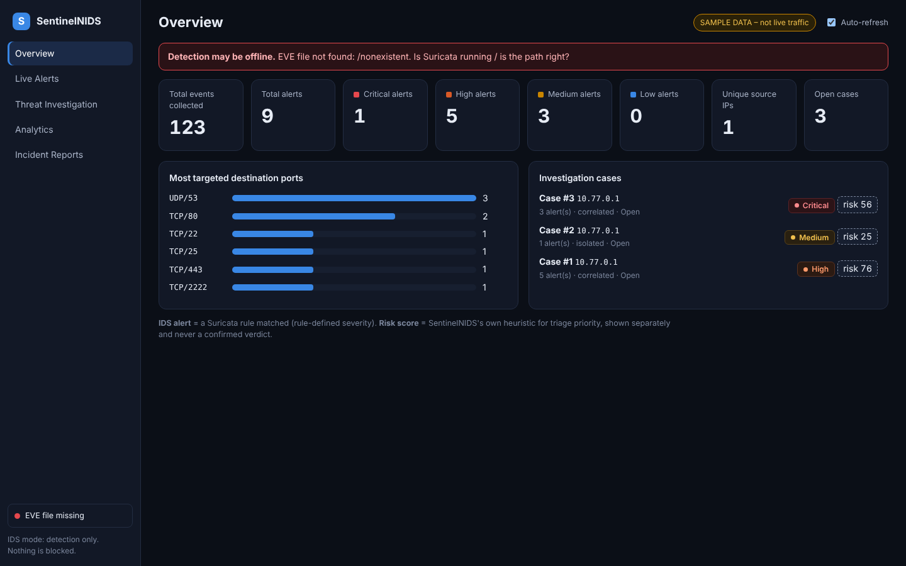

# SentinelNIDS

A small, **real** network-intrusion monitoring pipeline: **Suricata** detects, a **Python/Flask** backend parses EVE JSON into **SQLite**, correlates alerts into cases and scores them, and an **HTML/CSS/JS + Chart.js** dashboard supports triage, investigation and incident reports.

```
Traffic (curl/ping/nc/dig/nmap)  ->  Suricata (rules/local.rules)  ->  eve.json
        ->  backend/parser.py (tail + normalise)  ->  SQLite  ->  correlation.py (cases)  ->  risk_engine.py
        ->  Flask API (backend/app.py)  ->  dashboard (Overview | Live Alerts | Investigation | Analytics | Reports)
```


*Screenshots are taken from labelled SAMPLE data. Replace them with screenshots of your own live run.*

## What is real and what is calculated
| Thing | Source | Meaning |
|---|---|---|
| **IDS alert + severity** | Suricata rule match (`priority` 1-4 -> critical/high/medium/low) | "This rule matched this traffic" |
| **Case** | `correlation.py` | Alerts from one source grouped (gap <= 60 s; flagged when >= 3 alerts). **Lab configuration, not a standard.** |
| **Risk score 0-100** | `risk_engine.py` (documented, additive) | A *triage heuristic*. **Not a verdict.** Always shown with its breakdown and labelled "calculated". |

Nothing in the dashboard is fabricated. Data from `data/sample/eve.sample.json` is tagged `origin=sample` and the UI shows a **SAMPLE DATA** badge. Live data is `origin=live`.

## Lab architecture (lightest option: ONE Kali VM)
`scripts/lab_setup.sh` builds a network namespace "target" (10.77.0.2) joined to the Kali host (10.77.0.1) by a veth pair. Suricata monitors `veth-sentinel`. Nothing leaves your machine, so no second VM is needed. If you do have a second VM (e.g. Ubuntu on a VirtualBox host-only network), set `HOME_NET` and the `af-packet` interface in `config/suricata.yaml`, point `TARGET=` at it, and everything else is unchanged.

## Setup (Kali)
```bash
sudo apt update && sudo apt install -y suricata nmap tshark tcpdump python3-venv ethtool dnsutils netcat-openbsd
git clone <your repo> /opt/SentinelNIDS && cd /opt/SentinelNIDS
python3 -m venv .venv && . .venv/bin/activate && pip install -r requirements.txt

sudo ./scripts/lab_setup.sh up && sudo ./scripts/target_services.sh start
# edit config/suricata.yaml: HOME_NET, rule-files path, af-packet interface = veth-sentinel
sudo suricata -T -c config/suricata.yaml                 # validate config + rules first
sudo suricata -c config/suricata.yaml -i veth-sentinel   # run (terminal 1)
sudo ./scripts/capture_pcap.sh veth-sentinel             # optional PCAP linking (terminal 2)
sudo chmod a+r /var/log/suricata/eve.json                # let the backend read it
python backend/app.py                                    # terminal 3 -> http://127.0.0.1:5000
./scripts/run_scenarios.sh all                           # terminal 4: generates the 4 scenarios
```
`SENTINEL_EVE=/path/to/eve.json` overrides the log path. Development without Suricata: `python backend/app.py --load-sample --no-ingest` (labelled sample data).
The dashboard binds to 127.0.0.1 and has **no authentication** - do not expose it.

## Scenarios (see `tests/test_scenarios.md` for the results table to fill in)
1. Port scan (Nmap SYN/XMAS/NULL/-sV) -> SIDs 9000001-9000004, 9000040
2. Repeated connections to tcp/2222 -> SID 9000010 (rate only)
3. Suspicious DNS (blocklist zone, long name, burst) -> SIDs 9000020-22; each rule documents *why* it is suspicious
4. Normal traffic (curl, 4x ping, ordinary DNS) -> **must yield zero alerts**

## Repository layout
`rules/local.rules` custom rules · `config/suricata.yaml` · `backend/` (`app.py` API, `parser.py` EVE ingest, `correlation.py`, `risk_engine.py`, `database.py`, plus `config.py`, `pcap.py`, `reports.py`) · `dashboard/` · `scripts/` lab + traffic + sample generator · `docs/` · `reports/` · `tests/`.

Don't commit live logs, PCAPs, the DB or real IPs - `.gitignore` already excludes them.
**Authorised, isolated lab use only.** See `docs/limitations.md`.
